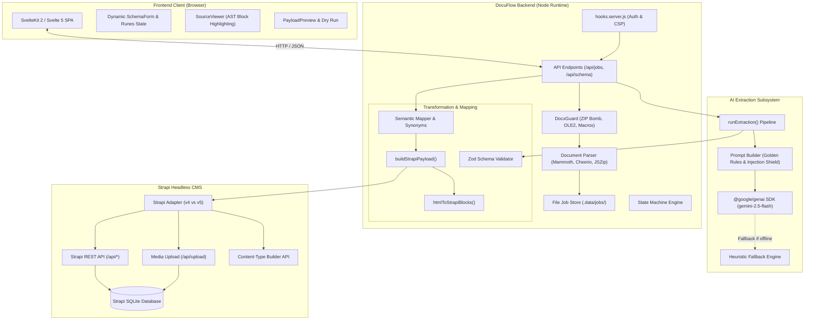
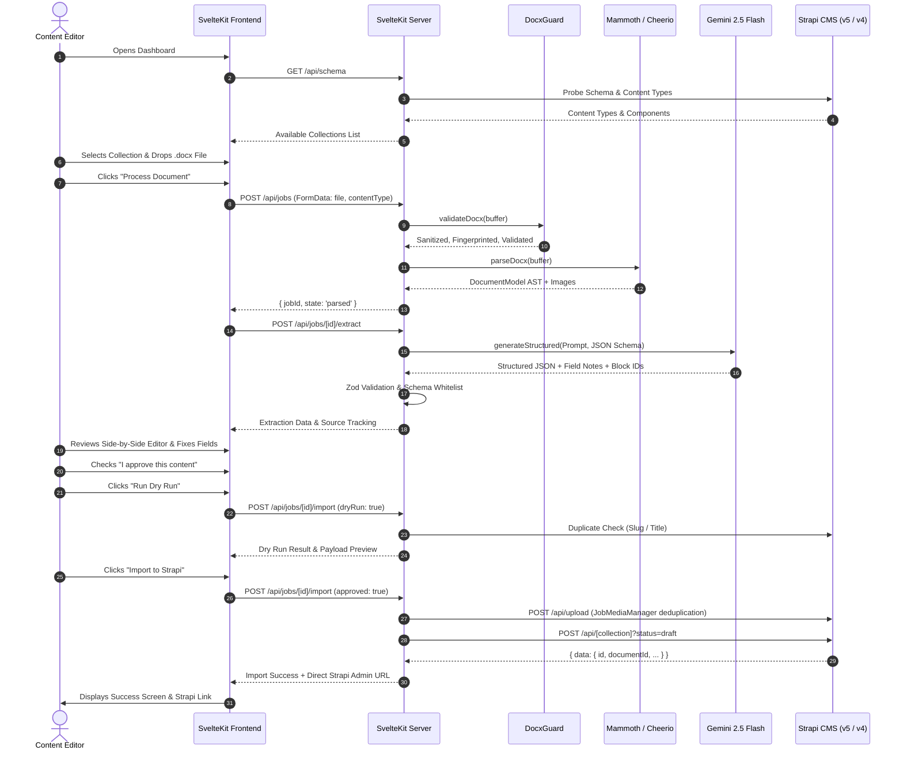
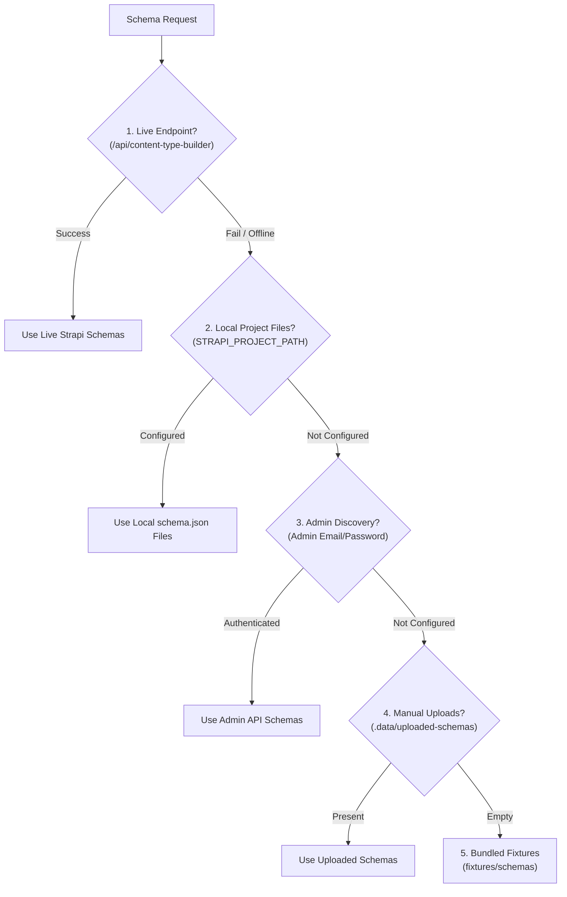

# DocuFlow: Document-to-Strapi Automation Platform
## Complete Technical Documentation & System Reference Manual

---

## 1. Project Overview

### 1.1 What is DocuFlow?
**DocuFlow** is an enterprise-grade document ingestion and content transformation system designed to automatically convert Microsoft Word documents (`.docx`) into structured, validated, and normalized entries within the **Strapi Headless Content Management System (CMS)**. 

Operating as a full-stack web application built on **SvelteKit 2 / Svelte 5**, DocuFlow bridges the gap between unstructured or semi-structured business documents and strictly typed headless CMS schemas. It combines deterministic document parsing, AST-level structure normalization, Large Language Model (LLM) semantic extraction via the **Google Gemini API**, schema drift detection, interactive human-in-the-loop validation, and adaptive REST adapters supporting both **Strapi v4** and **Strapi v5**.

```
+------------------+      +-------------------+      +--------------------+      +------------------+
|   Word Document  | ---> |   DocuFlow Core   | ---> |  Interactive Human | ---> |    Strapi CMS    |
|     (.docx)      |      |  Engine & Gemini  |      |   Review & Audit   |      |  (Draft Entry)   |
+------------------+      +-------------------+      +--------------------+      +------------------+
```

---

### 1.2 The Problem: Why Manual CMS Data Entry Fails
Modern marketing, editorial, and engineering teams frequently draft long-form content—such as technical articles, whitepapers, legal policies, service descriptions, and product comparisons—in desktop authoring software like Microsoft Word or Google Docs. However, delivering this content through headless architectures requires manual re-entry into a headless CMS like Strapi.

This manual data entry workflow suffers from major structural inefficiencies:
1. **High Labor Cost & Latency:** Copying complex documents containing nested accordions, SEO metadata, author profiles, multi-column tables, callout buttons, and embedded imagery takes anywhere from 30 to 90 minutes per document.
2. **Schema Impedance Mismatch:** Word documents do not share the relational, componentized hierarchy of a headless CMS. A single document page may contain data that maps across multiple Strapi single components (e.g., `AuthorData`, `seo`), repeatable components (e.g., `contentNew`), Strapi Blocks rich-text arrays, media fields, and relations.
3. **Table & Formatting Degradation:** Copying HTML or rich tables from desktop word processors into CMS editors often breaks column alignment, loses header associations (`<thead>` / `<th>`), or strips cell formatting.
4. **Human Copy-Paste Errors:** Manual transfer introduces formatting inconsistencies, broken links, dropped image references, omitted required fields, and typo-ridden slugs.
5. **Schema Drift Vulnerability:** If a developer alters a Strapi content-type schema (e.g., renaming a field or changing a component from single to repeatable), content editors without developer access easily misunderstand where data belongs.

---

### 1.3 How DocuFlow Automates the Workflow
DocuFlow eliminates manual transfer by creating an automated, resilient, and auditable pipeline:

1. **Deterministic Document Parsing:** Ingests binary `.docx` archives, inspects document relationships, unpacks embedded image streams, extracts hierarchical section paths, and converts complex nested tables into valid, semantic HTML markup (`<table><thead><tbody>`).
2. **Dynamic Schema Discovery:** Introspects the target Strapi instance in real time—discovering collection types, components, dynamic zones, repeatable arrays, relations, and validation rules directly from Strapi APIs, local configuration files, or uploaded schemas.
3. **AI-Assisted Semantic Mapping:** Uses Google Gemini (`gemini-2.5-flash` via `@google/genai`) or an offline heuristic engine to map document sections to schema attributes based on contextual semantics, avoiding rigid hardcoded regexes.
4. **Source Tracking & Confidence Scoring:** Tracks every extracted value back to its exact origin block in the Word document (e.g., `[b1]`, `[b14]`), assigning confidence scores (0.0 to 1.0).
5. **Interactive Review & Human-in-the-Loop Safeguard:** Presents a side-by-side verification interface where editors can see the parsed document with real-time highlighted source blocks alongside editable form controls, Zod schema validation warnings, and dry-run previews.
6. **Zero-Fabrication Guarantee:** Strictly follows the Golden Mapping Rule: if a document section does not belong to the target schema, it is ignored; if a schema field lacks source data, it remains empty (`null`, `""`, or `[]`). The system never hallucinates data.
7. **Safe Strapi Import:** Resolves and uploads embedded media buffers with SHA-256 deduplication, ensures unique URL slugs, handles duplicate conflicts, and creates entries as **Drafts by default** in Strapi v4 or Strapi v5.

---

### 1.4 Target Users and Practical Scenarios

| User Role | Practical Scenario | Tangible Benefit |
| :--- | :--- | :--- |
| **Content Operations & Editorial Teams** | Publishing batches of technical blog posts, guides, or whitepapers provided by external contributors in `.docx` format. | Cuts ingestion time from ~45 minutes to < 2 minutes per article; guarantees SEO and author components are preserved. |
| **Enterprise Migration Teams** | Migrating hundreds of legacy Word document pages, policies, and service sheets into a freshly deployed Strapi CMS. | Eliminates weeks of manual copy-paste; maps complex nested components and multi-row tables without layout destruction. |
| **Agencies & Client Services** | Receiving content deliverables from clients who only know how to work in Word or Docs. | Eliminates back-and-forth about CMS training; developers define schemas and editors ingest directly. |
| **Technical Writers** | Authoring complex product specifications containing structured data tables and embedded diagram snapshots. | Retains exact table columns, headers, and image references automatically. |

---

### 1.5 Objectives and Expected Outcomes
* **Speed:** Over 90% reduction in time-to-publish for structured Word documents.
* **Fidelity:** 100% preservation of document tables, column orders, and embedded images.
* **Data Integrity:** Strict server-side Zod validation prevents malformed payloads from polluting Strapi.
* **Safety:** Mandatory human review and draft-only creation ensures no unverified content goes live automatically.

---

## 2. Technology Stack

Every technology in DocuFlow was selected to fulfill specific architectural and security criteria:

```
+---------------------------------------------------------------------------------------+
|                                    FRONTEND LAYER                                     |
|  SvelteKit 2 / Svelte 5 (Runes: $state, $derived, $props) | Tailwind CSS v4 | Vite 8   |
+---------------------------------------------------------------------------------------+
                                           |
                                  HTTP / JSON & REST
                                           v
+---------------------------------------------------------------------------------------+
|                                 SVELTEKIT SERVER (Node)                               |
|  API Endpoints | Security Guard (Zip Bomb / OLE2) | Job Store | Session Auth (HMAC)   |
+---------------------------------------------------------------------------------------+
        |                                   |                                   |
        v                                   v                                   v
+------------------+            +-----------------------+           +-------------------+
|  DOC PROCESSING  |            |     AI EXTRACTION     |           |  STRAPI ADAPTERS  |
|  Mammoth 1.13    |            |  @google/genai 2.32   |           |  Client / v4 & v5 |
|  Cheerio 1.20    |            |  Gemini 2.5 Flash     |           |  Document Service |
|  JSZip 3.10      |            |  Zod 4 / JSON Schema  |           |  Better-SQLite3   |
+------------------+            +-----------------------+           +-------------------+
```

### 2.1 Frontend Technologies

#### SvelteKit 2 (`@sveltejs/kit` ^3.0.0) & Svelte 5 (`svelte` ^5.57.1)
* **Purpose:** Serves as the primary application framework for both the user interface and the backend serverless/node runtime.
* **Where Used:** Throughout `src/routes/` and `src/lib/components/`.
* **Why Selected:** Svelte 5's new reactivity model (**Runes**: `$state`, `$derived`, `$props`, `$effect`) allows reactive state synchronization between the parsed source document viewer and the target schema form without virtual DOM overhead.
* **Functionality:** Provides server-side rendering (SSR), client-side navigation, form actions, session-protected route hooks (`src/hooks.server.js`), and API endpoints.

#### Tailwind CSS v4 (`tailwindcss` ^4.3.0, `@tailwindcss/vite` ^4.3.0)
* **Purpose:** Modern utility-first styling system.
* **Where Used:** Configured in `vite.config.js` and imported globally in `src/routes/layout.css`.
* **Why Selected:** Tailwind v4 uses a lightning-fast Rust-based engine with pure CSS configuration (`@import "tailwindcss";`), providing responsive layouts for side-by-side document and schema editing.

#### UI Components & Reactive State
* **Purpose:** Modular components for source viewing, dynamic schema forms, and status feedback.
* **Where Used:** `src/lib/components/`:
  - `SourceViewer.svelte`: Renders parsed document blocks with bidirectional highlight tracking.
  - `SchemaForm.svelte`: Generates dynamic form inputs matching Strapi schema field types.
  - `RepeatableField.svelte`: Manages dynamic addition, deletion, and reordering of repeatable components.
  - `DynamicZoneField.svelte`: Manages Strapi Dynamic Zones with component discriminator (`__component`).
  - `RichTextEditor.svelte`: WYSIWYG / HTML editor for rich text fields.
  - `MediaField.svelte`: Displays thumbnail previews and handles image assignment.
  - `RelationField.svelte`: Searchable relational lookup combobox.
  - `MappingSummaryTable.svelte`: Displays field-by-field mapping confidence and source origins.
  - `ConfidenceBadge.svelte`: Color-coded confidence pill (High $\ge 0.8$, Medium $0.5 - 0.79$, Low $< 0.5$).
  - `IssuesPanel.svelte`: Lists Zod validation errors and document structural warnings.
  - `PayloadPreview.svelte`: Live JSON preview of the final Strapi payload before submission.
  - `ImportResult.svelte`: Success screen displaying entry IDs and one-click links to the Strapi Admin Panel.

---

### 2.2 Backend Technologies

#### Node.js Runtime & `@sveltejs/adapter-node` (^6.0.0)
* **Purpose:** Enterprise-grade standalone Node server production deployment.
* **Where Used:** Configured in `svelte.config.js`. Runs all server routes, file system I/O, and API integrations.

#### Zod (`zod` ^4.6.7)
* **Purpose:** Runtime schema validation and dynamic validation synthesis.
* **Where Used:**
  - `src/lib/server/env.js`: Validates all environment variables on boot.
  - `src/lib/server/schema/to-zod.js`: Dynamically compiles Strapi schemas into runtime Zod schemas to validate extracted content.
* **Why Selected:** Guarantees strict type safety and structured error reporting.

#### File-System Job Store
* **Purpose:** Persistent job queue and state machine storage.
* **Where Used:** `src/lib/server/jobs/store.js` and `state-machine.js`.
* **Details:** Stores uploaded files, parsed ASTs, extraction results, review drafts, and images inside `.data/jobs/[jobId]/`. Eliminates external database dependencies for job orchestration.

---

### 2.3 AI Integration Technologies

#### Google GenAI SDK (`@google/genai` ^2.32.0)
* **Purpose:** Official Google GenAI SDK for connecting to Gemini Large Language Models.
* **Where Used:** `src/lib/server/ai/gemini.js`.
* **Configured Model:** `gemini-2.5-flash` (configurable via `GEMINI_MODEL` in `.env`).
* **Structured Output Mechanism:** Uses `responseMimeType: 'application/json'` and `responseSchema` (generated dynamically by `contentTypeToJsonSchema` in `src/lib/server/schema/to-json-schema.js`).
* **Resilience & Fallback:** Implements multi-retry schema validation feedback (`AI_MAX_RETRIES`) and graceful automatic fallback to the internal rule-based engine (`fallback-heuristic.js` / `mock.js`) when offline or unconfigured.

---

### 2.4 Document Processing Technologies

#### Mammoth (`mammoth` ^1.13.0)
* **Purpose:** Fast, semantic DOCX-to-HTML conversion.
* **Where Used:** `src/lib/server/document/parser.js`.
* **Features:**
  - Custom style map translating Word paragraph styles (`Heading 1`-`6`, `Title`, `Subtitle`, `Quote`, `Intense Quote`) to semantic HTML tags.
  - Custom image converter (`mammoth.images.imgElement`) intercepting binary image parts, saving them into buffers with unique IDs (`img-1`, `img-2`), and substituting `docimg://img-X` URI tokens.

#### Cheerio (`cheerio` ^1.2.0)
* **Purpose:** Fast, server-side HTML DOM parsing and manipulation using jQuery syntax.
* **Where Used:** `src/lib/server/document/parser.js` and `src/lib/server/mapping/blocks.js`.
* **Features:**
  - Table transformation: converts raw tables into structured `<table><thead><tr><th>...<tbody><tr><td>` markup.
  - Recursive list extraction: unrolls nested ordered (`<ol>`) and unordered (`<ul>`) lists.
  - HTML-to-Strapi Blocks converter: transforms HTML elements into Strapi Blocks JSON AST.

#### JSZip (`jszip` ^3.10.2)
* **Purpose:** Low-level ZIP archive inspection and security screening.
* **Where Used:** `src/lib/server/security/docx-guard.js` and `src/lib/server/document/heuristics.js`.
* **Security & Inspection:**
  - Guards against Zip Bomb attacks by enforcing entry limits and uncompressed size ceilings.
  - Inspects `word/document.xml` for unsupported features: text boxes (`w:txbxContent`), tracked changes (`w:ins`/`w:del`), math formulas (`m:oMath`), headers/footers, and comments.

---

### 2.5 CMS Integration Technologies

#### Strapi Headless CMS (v5.60.0 & v4 Compatibility)
* **Installed Strapi Version:** **Strapi v5.60.0** located in the `cms/` workspace.
* **Database:** SQLite (`better-sqlite3` 12.11.1).
* **API Architecture:** Strapi REST API with Full Access API Token authentication.
* **Adapter Layer:**
  - `src/lib/server/strapi/adapters/v4.js`: Strapi v4 adapter (numeric IDs, `publishedAt: null` for drafts, `filters`, relation format `{ id }`).
  - `src/lib/server/strapi/adapters/v5.js`: Strapi v5 adapter (string `documentId`, `?status=draft` query parameters, Document Service relation syntax `{ connect: [documentId] }`).
  - `src/lib/server/strapi/detect-version.js`: Automatic runtime version negotiation.

---

### 2.6 Development & Testing Technologies

* **Package Manager:** `npm` (configured with project scripts).
* **Test Runner:** **Vitest** (`vitest` ^4.1.8) running 7 test suites (40 tests across schemas, strapi client, document parser, document guard, jobs, contentNew tables, and AI mapping).
* **Linter & Formatter:** ESLint 10 (`eslint`, `eslint-plugin-svelte`) and Prettier 3 (`prettier`, `prettier-plugin-svelte`, `prettier-plugin-tailwindcss`).
* **Mock Strapi Server:** `scripts/mock-strapi.js` providing an in-memory Strapi REST API server for testing without running the full Strapi daemon.

---

## 3. Project Architecture

### 3.1 High-Level System Architecture Diagram



---

### 3.2 Component Responsibilities

#### 1. Client-Side Layer (`src/routes/`, `src/lib/components/`)
* Manages user interactions: drag-and-drop document upload, target collection selection, field editing, and manual override.
* Tracks bidirectional visual focus: clicking an input highlights corresponding `[bID]` blocks in the document viewer.
* Displays schema validation errors, warnings, unmapped document sections, and mapping confidence.
* Executes non-destructive Dry Runs and submits human-approved import payloads.

#### 2. Server-Side Processing Layer (`src/lib/server/`)
* **Security & Auth:** Verifies HMAC-SHA256 session cookies, enforces constant-time password comparison, checks IP rate limits, and redacts sensitive credentials from logs.
* **Document Parsing:** Unpacks DOCX archives, detects unsupported Word features, sanitizes filenames, extracts images, and produces structured `DocumentModel` ASTs.
* **Job State Machine:** Enforces strict transition sequences (`uploaded` $\rightarrow$ `parsed` $\rightarrow$ `extracted` $\rightarrow$ `reviewed` $\rightarrow$ `importing` $\rightarrow$ `imported`).
* **Payload Serialization:** Converts reviewed values into Strapi-compliant data structures (HTML tables to rich text, inline markup to Strapi Blocks JSON AST, relations to connection objects).

#### 3. AI Extraction Subsystem (`src/lib/server/ai/`)
* Compiles target Strapi schema attributes into JSON Schema specifications.
* Formulates hardened extraction prompts that treat document text as untrusted data.
* Calls `ai.models.generateContent` with structured JSON mode enabled.
* Validates responses against Zod schemas; feeds errors back into retry loops up to `AI_MAX_RETRIES`.
* Falls back gracefully to heuristic extraction if the external AI service fails or is disabled.

#### 4. Strapi CMS Layer (`cms/` & `src/lib/server/strapi/`)
* Discovers available collections, attributes, and component structures dynamically.
* Detects Strapi version (v4 vs v5) and adjusts payload formats accordingly.
* Handles media uploads with hash deduplication via `JobMediaManager`.
* Creates and updates entries, guaranteeing draft status unless explicitly overridden.

---

### 3.3 Security and Data Isolation
* **Untrusted Document Boundary:** Document content is treated strictly as plain data within `<DOCUMENT>` tags in AI prompts. The prompt explicitly instructs the LLM to ignore instructions embedded in the document text.
* **Macro & Binary Rejection:** All legacy `.doc` files, macro-enabled `.docm` files, and malformed ZIP files are rejected before parsing begins.
* **Credential Isolation:** The client never receives Strapi API tokens or Gemini API keys. All external requests are proxied server-side.
* **Log Redaction:** All server logs pass through `src/lib/server/security/redact.js`, replacing known secrets, API tokens, passwords, and Bearer headers with `[REDACTED]`.

---

## 4. Complete Folder Structure

The DocuFlow codebase is organized cleanly into modular, purpose-specific directories:

```
Docuflow/
├── .data/                                # Local persistent storage (jobs, uploaded schemas)
│   ├── jobs/                             # Individual job folders (<jobId>/source.docx, job.json, etc.)
│   └── uploaded-schemas/                 # User-uploaded Strapi schema JSON files
├── cms/                                  # Full Strapi v5.60.0 Headless CMS instance
│   ├── src/
│   │   ├── api/                          # Strapi Collection Types
│   │   │   ├── article/                  # Article collection (schema.json, controller, router)
│   │   │   ├── blog/                     # Blog collection with contentNew repeatable component
│   │   │   └── poll/                     # Poll collection
│   │   └── components/                   # Strapi Components
│   │       ├── button/                   # CTA button component
│   │       └── component/                # author-data, content-new, options, poll-data, seo
│   ├── package.json                      # Strapi dependencies (@strapi/strapi 5.60.0)
│   └── tsconfig.json                     # Strapi TypeScript configuration
├── config/
│   └── hints/                            # Domain-specific mapping hints (e.g., service-page.json)
├── fixtures/                             # Test fixtures and reference documents
│   ├── docs/                             # Real-world test DOCX files (with tables, accordions, images)
│   └── schemas/                          # Bundled fallback schemas (Article, Service Page)
├── scripts/                              # Operational and development CLI utilities
│   ├── make-fixtures.js                  # Generates synthetic .docx test files programmatically
│   ├── mock-strapi.js                    # Zero-dependency mock Strapi v4/v5 server for offline testing
│   ├── smoke.js                          # End-to-end smoke test script
│   └── sync-strapi-token.js              # Auto-syncs Strapi API token between root .env and SQLite DB
├── src/                                  # SvelteKit application source
│   ├── app.d.ts                          # SvelteKit ambient type definitions
│   ├── app.html                          # HTML page shell
│   ├── hooks.server.js                   # Server request hook (authentication, CSP, security headers)
│   ├── lib/
│   │   ├── assets/                       # Static UI assets (favicon.svg)
│   │   ├── components/                   # Svelte 5 UI components
│   │   │   ├── ConfidenceBadge.svelte    # Mapping confidence score indicator
│   │   │   ├── DynamicZoneField.svelte   # Strapi Dynamic Zone form handler
│   │   │   ├── ImportResult.svelte       # Final import status & Strapi Admin links
│   │   │   ├── IssuesPanel.svelte        # Zod validation & structural issue viewer
│   │   │   ├── MappingSummaryTable.svelte# Detailed field-by-field mapping table
│   │   │   ├── MediaField.svelte         # Image assignment & preview component
│   │   │   ├── PayloadPreview.svelte     # Strapi JSON payload viewer
│   │   │   ├── RelationField.svelte      # Relational entity search & select
│   │   │   ├── RepeatableField.svelte    # Repeatable component item list manager
│   │   │   ├── RichTextEditor.svelte     # Inline HTML / rich text editor
│   │   │   ├── SchemaForm.svelte         # Dynamic recursive form generator
│   │   │   ├── SourceViewer.svelte       # Highlightable source document viewer
│   │   │   └── Stepper.svelte            # Workflow progress stepper (Upload > Review > Import)
│   │   ├── server/                       # Server-side business logic
│   │   │   ├── ai/                       # AI extraction subsystem
│   │   │   │   ├── chunking.js           # Multi-section document merger
│   │   │   │   ├── extract.js            # Main extraction orchestration with retries
│   │   │   │   ├── fallback-heuristic.js # Rule-based extraction fallback
│   │   │   │   ├── gemini.js             # Google GenAI SDK integration
│   │   │   │   ├── mock.js               # Mock AI provider for offline development
│   │   │   │   ├── prompt.js             # LLM prompt builder & injection defense
│   │   │   │   └── provider.js           # AIProvider interface definition
│   │   │   ├── document/                 # DOCX parsing & AST modeling
│   │   │   │   ├── heuristics.js         # Word feature detection & fake heading promotion
│   │   │   │   ├── intermediate.js       # Intermediate key-value extraction model
│   │   │   │   ├── model.js              # DocumentModel and Block type definitions
│   │   │   │   ├── parser.js             # Core Mammoth + Cheerio DOCX parser
│   │   │   │   └── to-markdown.js        # Markdown serialization with [bID] tags
│   │   │   ├── env.js                    # Zod-validated environment configuration
│   │   │   ├── jobs/                     # Job management & persistence
│   │   │   │   ├── state-machine.js      # Legal job state transition validator
│   │   │   │   └── store.js              # File-based job storage engine
│   │   │   ├── mapping/                  # Data transformation & normalization
│   │   │   │   ├── blocks.js             # HTML to Strapi Blocks JSON AST converter
│   │   │   │   ├── build-payload.js      # Strapi payload constructor & whitelister
│   │   │   │   ├── hints.js              # Custom hint loaders
│   │   │   │   ├── richtext.js           # HTML to Markdown converter
│   │   │   │   ├── semantic-mapper.js    # Synonym matching & heuristic mapping engine
│   │   │   │   └── slug.js               # Slug generator & Strapi uniqueness checker
│   │   │   ├── schema/                   # Schema discovery & compilation
│   │   │   │   ├── loader-admin.js       # Live Strapi Admin API discovery
│   │   │   │   ├── loader-endpoint.js    # Content-type builder endpoint loader
│   │   │   │   ├── loader-files.js       # Local schema.json file loader
│   │   │   │   ├── loader-upload.js      # User-uploaded schema loader
│   │   │   │   ├── normalize.js          # Schema attribute normalizer
│   │   │   │   ├── resolve.js            # Prioritized schema discovery cascade
│   │   │   │   ├── to-json-schema.js     # Schema-to-JSON-Schema compiler for Gemini
│   │   │   │   └── to-zod.js             # Schema-to-Zod runtime validator compiler
│   │   │   ├── security/                 # Application security utilities
│   │   │   │   ├── auth.js               # Constant-time comparison & session tokens
│   │   │   │   ├── docx-guard.js         # Zip bomb & malicious file validator
│   │   │   │   ├── rate-limit.js         # In-memory sliding window rate limiters
│   │   │   │   └── redact.js             # Credential scrubbing from logs
│   │   │   └── strapi/                   # Strapi client & version adapters
│   │   │       ├── adapter.js            # Version adapter factory
│   │   │       ├── client.js             # Resilient fetch wrapper with retry/backoff
│   │   │       ├── detect-version.js     # Automatic Strapi v4 vs v5 detector
│   │   │       ├── errors.js             # Strapi error parser & normalizer
│   │   │       ├── media.js              # Media upload manager with SHA-256 deduplication
│   │   │       ├── relations.js          # Relational search & candidate resolver
│   │   │       └── adapters/
│   │   │           ├── v4.js             # Strapi v4 REST adapter
│   │   │           └── v5.js             # Strapi v5 REST adapter
│   │   └── shared/
│   │       └── slug.js                   # Universal URL-safe slug generator
│   └── routes/                           # SvelteKit application routes
│       ├── +layout.svelte                # Root application layout
│       ├── +page.svelte                  # Upload & collection selection page
│       ├── layout.css                    # Tailwind CSS v4 entry point
│       ├── api/                          # Server API routes
│       │   ├── health/+server.js         # Health check endpoint
│       │   ├── jobs/+server.js           # Job listing and upload endpoint
│       │   ├── jobs/[id]/+server.js      # Job retrieval endpoint
│       │   ├── jobs/[id]/extract/+server.js # AI extraction trigger endpoint
│       │   ├── jobs/[id]/images/[imageId]/+server.js # Extracted image retrieval endpoint
│       │   ├── jobs/[id]/import/+server.js  # Final Strapi import / Dry Run endpoint
│       │   ├── jobs/[id]/review/+server.js  # Review saving & validation endpoint
│       │   ├── schema/+server.js         # Schema resolution & upload endpoint
│       │   └── strapi/
│       │       ├── relations/+server.js  # Relational candidate search endpoint
│       │       └── test/+server.js       # Strapi connectivity test endpoint
│       ├── history/                      # Job history page (+page.svelte, +page.server.js)
│       ├── jobs/[id]/                    # Review & editing page (+page.svelte, +page.server.js)
│       ├── login/                        # Authentication login page
│       └── settings/                     # CMS & AI settings page
├── static/                               # Static web server files
├── tests/                                # Vitest automated test suite
│   ├── ai-mapping.test.js                # AI mapping & synonym tests
│   ├── content-new-tables.test.js        # Repeatable components & HTML table extraction tests
│   ├── document-guard.test.js            # Security screening & zip bomb tests
│   ├── document-parser.test.js           # Mammoth & Cheerio parser tests
│   ├── jobs.test.js                      # Job lifecycle & state machine tests
│   ├── schema.test.js                    # Schema discovery & compilation tests
│   └── strapi.test.js                    # Strapi v4/v5 adapter tests
├── .env.example                          # Reference environment variables template
├── eslint.config.js                      # ESLint configuration
├── jsconfig.json                         # Path alias & JavaScript configuration
├── package.json                          # Root project dependencies & scripts
├── prettier.config.js                    # Prettier formatting rules
├── vite.config.js                        # Vite bundler & Tailwind configuration
└── vitest.config.js                      # Vitest test runner configuration
```

---

## 5. Complete Project Workflow

DocuFlow executes an end-to-end 9-step pipeline that ensures every document is safely ingested, accurately understood, validated, and transferred to Strapi.



---

### Step 1: Collection Selection
1. When the user navigates to the application (`/`), the frontend calls `GET /api/schema`.
2. The server introspects available Strapi content types using the **Prioritized Schema Cascade** (detailed in Section 7).
3. The user selects the target collection type from a searchable dropdown (e.g., `Blog`, `Article`, `Service Page`).
4. The selected `contentTypeUid` (e.g., `api::blog.blog`) is bound into the UI state and locked into the job metadata upon upload.

---

### Step 2: Schema Retrieval & Dynamic Compilation
1. Upon collection selection, `GET /api/schema?uid=[uid]&refresh=true` fetches the full normalized definition:
   - Identifies all primitive fields (`string`, `text`, `richtext`, `blocks`, `number`, `boolean`, `date`, `enumeration`, `uid`).
   - Identifies nested single components (e.g., `seo`, `AuthorData`) and repeatable components (e.g., `contentNew`).
   - Resolves dynamic zones and allowable member components.
2. Computes an initial SHA-256 fingerprint:
   $$\text{Fingerprint} = \text{SHA256}(\text{JSON.stringify}(\text{schema.attributes}))$$
   This fingerprint is stored alongside the job to detect any subsequent schema drift.

---

### Step 3: Document Upload & Security Screening
1. The user drags and drops a `.docx` file into the upload zone or selects it via the file browser.
2. The frontend enforces a `.docx` extension check.
3. The file is uploaded via `POST /api/jobs` as multipart form data.
4. **Security Screening (`validateDocx` in `docx-guard.js`):**
   - **Buffer Check:** Verifies buffer length $> 0$ and $\le \text{MAX\_UPLOAD\_MB}$ (default 10 MB).
   - **Header Verification:** Checks for the standard ZIP magic bytes (`PK\x03\x04` or `PK\x05\x06`).
   - **Legacy Rejection:** Rejects legacy OLE2 CFBF binary Word documents (`0xD0, 0xCF, 0x11, 0xE0`).
   - **Filename Sanitization:** Strips directory traversal sequences (`../`, `..\`) and special characters.
   - **Zip Bomb Guard:** Verifies entry count does not exceed 1,000 entries and uncompressed byte size does not exceed 50 MB.
   - **Macro Rejection:** Strictly rejects macro files containing `vbaProject.bin`, `.vba`, or `macrosheets`.
   - **Integrity Check:** Confirms `word/document.xml` exists in the archive.
   - **Fingerprinting:** Computes the document's SHA-256 hash.
5. The job is created in `.data/jobs/[jobId]/` in the `uploaded` state.

---

### Step 4: Document Parsing & Content Extraction
The server parses the document buffer using `parseDocx` (`src/lib/server/document/parser.js`):
1. **Mammoth HTML Conversion:** Translates `.docx` styling into clean HTML using a custom style map (`Heading 1`-`6`, `Title`, `Quote`).
2. **Image Stream Extraction:** Mammoth's `convertImage` handler extracts binary images, stores them in memory with IDs (`img-1`, `img-2`), and replaces image tags with `docimg://img-X`.
3. **Unsupported Feature Detection:** JSZip inspects `word/document.xml` for text boxes (`w:txbxContent`), tracked revisions (`w:ins`/`w:del`), and mathematical formulas (`m:oMath`), emitting non-fatal warnings to inform the user.
4. **Cheerio DOM Traversal:**
   - **Paragraphs & Quotes:** Extracted and assigned incremental block IDs (`b1`, `b2`, etc.).
   - **Headings:** Semantic headings (`<h1>`-`<h6>`) are extracted with hierarchy levels.
   - **Lists:** Ordered (`<ol>`) and unordered (`<ul>`) lists are recursively extracted, preserving indentation levels.
   - **Tables & Nested Tables:**
     - Nested tables inside table cells are unrolled into clean HTML table strings.
     - Tables are converted into clean HTML markup:
       ```html
       <table>
         <thead><tr><th>Column 1</th><th>Column 2</th></tr></thead>
         <tbody><tr><td>Value 1</td><td>Value 2</td></tr></tbody>
       </table>
       ```
     - Cell images are tracked with their `img-X` tokens.
5. **Heuristic Promotion:**
   - Detects "fake headings" (e.g., standalone short bold paragraphs or ALL-CAPS lines without formal Word heading styles) and promotes them to heading blocks.
   - Constructs hierarchical section paths (e.g., `["Introduction", "Technical Details"]`).
   - Associates each extracted image with its nearest preceding heading.
6. **Markdown Serialization:** Generates a compact Markdown representation annotated with block ID tags (e.g., `# Document Title [b1]`, `[b2] This is a paragraph.`).
7. Saves the resulting `DocumentModel` AST and extracted images to `.data/jobs/[jobId]/`, transitioning the state to `parsed`.

---

### Step 5: AI-Based Content Understanding
The frontend requests extraction via `POST /api/jobs/[id]/extract`:
1. **Schema Compilation:** `contentTypeToJsonSchema` converts the Strapi content-type schema into a strict JSON Schema definition.
2. **Prompt Construction (`buildExtractionPrompt`):**
   - Lists target schema fields, types, and descriptions.
   - Embeds the document's Markdown with its `[bID]` block tags inside `<DOCUMENT>` tags.
   - Enforces the **Critical Rules** (Untrusted Data, Golden Mapping Rule, Zero Hallucination, Source Tracking).
3. **Structured Generation (`geminiProvider`):**
   - Calls `@google/genai` with `model: 'gemini-2.5-flash'`, `responseMimeType: 'application/json'`, and `responseSchema`.
4. **Validation & Retry Loop:**
   - The returned JSON is parsed and validated against the runtime Zod schema (`validateContentData`).
   - If validation fails, error messages are appended to the prompt under `[RETRY NOTICE]` and resubmitted (up to `AI_MAX_RETRIES` times).
   - If retries fail or the AI service is unreachable, the system automatically falls back to `extractHeuristics()`.
5. **Schema Whitelisting:** Any properties generated by the model that are not defined in the Strapi schema are stripped.
6. The extraction result (data, `fieldNotes` with confidence scores and source block IDs, warnings, and unmapped sections) is saved to disk, transitioning the job to `extracted`.

---

### Step 6: Schema-Aware Data Mapping

DocuFlow applies four foundational mapping rules across all field types:

```
+---------------------------------------------------------------------------------------+
|                               FOUR CORE MAPPING RULES                                 |
|                                                                                       |
|  Rule 1: Schema Field Exists + Content Found    --> Map & Populate Value              |
|  Rule 2: Schema Field Exists + Content Missing  --> Keep Empty (null, "", [])         |
|  Rule 3: Document Content Exists + Field Lacks  --> Strictly Ignore & Record Unmapped |
|  Rule 4: Ambiguous Mapping                      --> Flag for Manual Review            |
+---------------------------------------------------------------------------------------+
```

#### Field-Specific Mapping Behavior:
* **Primitive Fields (`string`, `text`):** Verbatim plain text extracted from matching sections.
* **Rich Text / Blocks (`richtext`, `blocks`):**
  - For Strapi `richtext` fields: Preserves clean Markdown or HTML.
  - For Strapi `blocks` fields: `htmlToStrapiBlocks()` converts HTML into Strapi Blocks JSON AST.
* **HTML Tables:**
  - When mapping to a `text` attribute inside a component (e.g., `contentNew.content`), the complete semantic HTML table (`<table><thead><tbody></table>`) is preserved verbatim.
  - When mapping to a `blocks` attribute, tables are converted into formatted blocks with bold headers and column pairs (`Header: Value | ...`).
* **Repeatable Components (e.g., `contentNew`):** Extracted from repeated document sections, bullet lists, or table rows into arrays of component objects.
* **Single Components (e.g., `AuthorData`, `seo`):** Extracted into nested objects matching component attributes.
* **Media Fields:** Nearest embedded image references (`img-1`, `img-2`) are mapped as `{ $docImage: "img-1" }`.
* **Relation Fields:** The AI returns the human-readable entity name (e.g., category name); internal numeric IDs are resolved later.
* **UID / Slug Fields:** Auto-generated from title fields via URL-safe kebab-case formatting (`generateSlug`).

---

### Step 7: Validation and Interactive Review
1. The user is redirected to `/jobs/[id]`, displaying a split-screen interface:
   - **Left Pane (`SourceViewer`):** Interactive rendering of the original document blocks.
   - **Right Pane (`SchemaForm`):** Dynamically generated form fields containing extracted data.
2. **Visual Source Tracing:** Clicking or focusing any form field immediately scrolls to and highlights the corresponding source blocks in the document viewer.
3. **Issues & Validation Panel:** Displays real-time Zod schema validation errors (e.g., missing required fields, string length violations) and structural warnings.
4. **Manual Editing:** The user can freely edit values, add or remove repeatable items, or adjust media selections.
5. **Dry Run (`POST /api/jobs/[id]/import` with `dryRun: true`):**
   - Validates the complete payload without writing to Strapi.
   - Checks Strapi for duplicate entries by slug and title.
   - Generates a live preview of the final serialized Strapi payload.
6. **Mandatory Approval:** The user must explicitly check the approval checkbox (`"I have reviewed this content and approve it for import into Strapi"`). Imports cannot proceed without this confirmation.

---

### Step 8: Strapi Data Import
Upon user confirmation, `POST /api/jobs/[id]/import` executes:
1. **Schema Drift Check:** Verifies that the target Strapi collection schema has not changed since extraction by re-checking the SHA-256 fingerprint.
2. **Required Fields Check:** Enforces that all required schema attributes are populated.
3. **Duplicate Resolution:** If a duplicate entry is detected by title or slug:
   - `cancel`: Aborts import and prompts user.
   - `create_new`: Calls `ensureUniqueSlug()` to append numeric suffixes (e.g., `article-title-1`).
   - `update`: Updates the existing draft entry in place.
4. **Media Upload & Resolution (`JobMediaManager`):**
   - Traverses the payload recursively to locate `{ $docImage: "img-X" }` placeholders.
   - Uploads binary image buffers to Strapi's `/api/upload` endpoint.
   - Computes SHA-256 hashes of image buffers to prevent uploading duplicate images.
   - Replaces placeholders with the uploaded Strapi media ID.
5. **Payload Serialization (`buildStrapiPayload`):** Transforms the data into the exact format expected by the detected Strapi version adapter.
6. **Draft Entry Creation:**
   - Calls the adapter's `create()` method.
   - Sets `?status=draft` (Strapi v5) or `publishedAt: null` (Strapi v4).
   - Guarantees the entry is saved as a **Draft**.
7. Updates the job state to `imported`, storing the returned Strapi `entryId`, `documentId`, and `adminUrl`.

---

### Step 9: Final Result & Verification
1. The user interface transitions to `ImportResult.svelte`.
2. Displays the created Strapi entry ID, documentId, and publication status (`Draft`).
3. Provides a direct, one-click link to open the newly created draft entry inside the Strapi Admin Panel:
   - Strapi v5: `http://localhost:1337/admin/content-manager/collection-types/api::[name].[name]/[documentId]`
   - Strapi v4: `http://localhost:1337/admin/content-manager/collectionType/api::[name].[name]/[id]`
4. The content editor can open the link in Strapi, inspect the imported components and tables, make final adjustments, and publish.

---

## 6. AI Model and Pricing Explanation

### 6.1 Model Configuration and SDK
* **AI Provider:** Google Gemini API.
* **Official SDK:** `@google/genai` (version `^2.32.0`).
* **Configured Model Identifier:** `gemini-2.5-flash` (configurable via `GEMINI_MODEL` in `.env`).
* **Configuration Location:** `src/lib/server/ai/gemini.js` and `src/lib/server/env.js`.
* **API Key Requirement:** Requires `GEMINI_API_KEY` when `AI_PROVIDER=gemini`.

```javascript
// Actual SDK initialization in src/lib/server/ai/gemini.js
import { GoogleGenAI } from '@google/genai';

const ai = new GoogleGenAI({ apiKey: env.GEMINI_API_KEY });
const response = await ai.models.generateContent({
    model: env.GEMINI_MODEL || 'gemini-2.5-flash',
    contents: prompt,
    config: {
        responseMimeType: 'application/json',
        responseSchema: jsonSchema
    }
});
```

---

### 6.2 Why `gemini-2.5-flash` Was Selected
1. **Native Structured JSON Output:** Gemini models support native schema-constrained JSON generation via `responseSchema`, guaranteeing valid JSON responses that adhere to the provided schema.
2. **Massive Context Window:** Capable of ingesting comprehensive multi-page Word documents (up to 1 million tokens), eliminating arbitrary document size truncations.
3. **High Extraction Speed:** Flash models are engineered for low-latency inference, completing complex document extractions within 1 to 3 seconds.
4. **Cost Efficiency:** Significantly lower token pricing compared to larger frontier models while delivering equivalent accuracy on structured extraction tasks.

---

### 6.3 Google Gemini Pricing Tiers & Quota Explanation

> [!NOTE]
> The codebase specifies the model and SDK, but your actual billing status depends on your Google AI Studio account plan.

Google Gemini models offer two distinct billing plans:

#### 1. Free Tier (Google AI Studio)
* **Cost:** **$0.00 / free of charge**.
* **API Key:** Obtained from [Google AI Studio](https://aistudio.google.com/).
* **Rate Limits:**
  - 15 Requests Per Minute (RPM)
  - 1,500 Requests Per Day (RPD)
  - 1,000,000 Tokens Per Minute (TPM)
* **Data Logging:** Free tier prompts and outputs may be logged and reviewed by human reviewers to train and improve Google products.
* **Suitable For:** Local development, testing, staging environments, and moderate operational workloads (< 1,500 documents/day).

#### 2. Pay-As-You-Go Paid Tier
* **Cost:** Billed per token consumed. According to the [official Google Gemini API Pricing Documentation](https://ai.google.dev/pricing):
  - **Input Tokens:** Approximately \$0.075 to \$0.15 per 1,000,000 tokens (for prompts $\le 128\text{k}$ tokens).
  - **Output Tokens:** Approximately \$0.30 to \$0.60 per 1,000,000 tokens.
* **Rate Limits:** Up to 1,000+ RPM and 4,000,000+ TPM.
* **Data Privacy:** Prompts and outputs are **not** logged or used for model training.
* **Suitable For:** Production deployments, commercial workloads, sensitive internal business documents, and automated high-throughput pipelines.

#### What Happens When Quotas Are Exhausted?
* If the free quota or rate limit is exceeded, the Gemini API returns an HTTP 429 (`RESOURCE_EXHAUSTED`) error.
* DocuFlow intercepts this error in `src/lib/server/ai/gemini.js`:
  ```javascript
  if (/quota|resource_exhausted|429/i.test(safeMessage)) {
      throw new Error('Gemini API quota exceeded or rate limit reached. Please try again shortly.');
  }
  ```
* In `src/lib/server/ai/extract.js`, when retries are exhausted, DocuFlow automatically activates the **Heuristic Fallback Engine** (`extractHeuristics()`), completing the extraction without crashing.

---

### 6.4 Cost Optimization Strategies Implemented
1. **Compact Markdown Serialization:** Documents are serialized into compact Markdown with block tags (`[b1]`) rather than bloated HTML, reducing input token count by 60–80%.
2. **Schema Whitelisting:** Dropping unneeded attributes before building prompts reduces JSON schema size.
3. **Offline Mock Provider:** Setting `AI_PROVIDER=mock` in `.env` runs the full heuristic extraction engine locally with zero API token consumption, ideal for CI/CD test suites and local UI development.
4. **Job Media Hashing:** Image buffers are hashed with SHA-256 to avoid redundant processing.

---

## 7. Strapi Integration and Schema Synchronization

### 7.1 Strapi Connection Configuration
Configured in root `.env`:
* `STRAPI_URL`: Base URL of the Strapi instance (e.g., `http://localhost:1337`).
* `STRAPI_API_TOKEN`: Strapi API Token with Full Access permissions.
* `STRAPI_VERSION`: `'auto'` (default), `'4'`, or `'5'`.
* `STRAPI_ADMIN_EMAIL` / `STRAPI_ADMIN_PASSWORD`: Optional credentials for live schema discovery via the Strapi Admin API.
* `STRAPI_PROJECT_PATH`: Optional path to local Strapi directory (reads `src/api/*/content-types/*/schema.json`).

---

### 7.2 Prioritized Schema Discovery Cascade
DocuFlow discovers schemas through a 5-tier fallback cascade in `src/lib/server/schema/resolve.js`:



1. **Live Strapi Schema Endpoint:** Probes `/api/content-type-builder/content-types` if Strapi is online.
2. **Local Project Files:** Reads `schema.json` from `src/api/*/content-types/*/` and `src/components/*/*.json` if `STRAPI_PROJECT_PATH` is set.
3. **Live Admin Discovery:** Authenticates against `/admin/login` using `STRAPI_ADMIN_EMAIL` and fetches schemas from the Admin API.
4. **User Manual Uploads:** Reads schemas previously uploaded through the UI stored in `.data/uploaded-schemas/`.
5. **Bundled Fallback Fixtures:** Reads standard reference schemas from `fixtures/schemas/` (guaranteeing offline resilience).

---

### 7.3 Schema Drift & Modification Detection
A critical challenge in CMS integration is **schema drift**—when a developer modifies, renames, or deletes fields in Strapi after a document has already been extracted.

DocuFlow handles schema drift proactively:
1. **Fingerprinting on Extraction:** When extraction occurs, a SHA-256 hash of the schema attributes is computed and stored:
   ```javascript
   const schemaFingerprint = crypto
       .createHash('sha256')
       .update(JSON.stringify(schema.attributes || {}))
       .digest('hex');
   ```
2. **Verification on Import:** Before importing (`/api/jobs/[id]/import`), DocuFlow re-fetches the live Strapi schema with `forceRefresh: true` and compares the new fingerprint with the stored extraction fingerprint.
3. **Drift Alert (HTTP 409 Conflict):** If the schema has changed, DocuFlow halts the import and returns a conflict error:
   ```json
   {
     "schemaChanged": true,
     "error": {
       "code": "SCHEMA_MODIFIED",
       "message": "The schema for \"Blog\" was modified in Strapi since document extraction. Please revalidate your reviewed fields."
     }
   }
   ```
4. **Adaptive Whitelisting:** Any fields removed from Strapi are stripped from the payload automatically, preventing Strapi 400 validation errors.

---

### 7.4 Version Adapters: Strapi v4 vs Strapi v5
DocuFlow abstracts all version differences through dedicated adapter implementations:

| Architectural Dimension | Strapi v4 Adapter (`v4.js`) | Strapi v5 Adapter (`v5.js`) |
| :--- | :--- | :--- |
| **Primary Identifier** | Numeric `id` (e.g., `42`) | Alphanumeric `documentId` (e.g., `c2d8e4f1a9`) |
| **Draft Creation** | `{ data: { ...payload, publishedAt: null } }` | `POST /api/[endpoint]?status=draft` |
| **Draft Querying** | `GET /api/[endpoint]?publicationState=preview` | `GET /api/[endpoint]?status=draft` |
| **Publishing Entry** | `PUT /api/[endpoint]/[id]` with `publishedAt: <ISO>` | `POST /api/[endpoint]/[documentId]/publish` |
| **Relation Formatting** | `{ id: 12 }` or `[12, 15]` | `{ connect: ["docId12"] }` |
| **Admin Entry Link** | `/admin/content-manager/collectionType/api::[name].[name]/[id]` | `/admin/content-manager/collection-types/api::[name].[name]/[documentId]` |
| **Response Structure** | `{ data: { id: 1, attributes: { ... } } }` | `{ data: { id: 1, documentId: "...", ...attributes } }` |

---

## 8. API Routes and Internal Functions

### 8.1 API Endpoints Table

| File / Endpoint | HTTP Method | Input | Output | Purpose & Responsibility |
| :--- | :---: | :--- | :--- | :--- |
| `src/routes/api/health/+server.js` | `GET` | None | `{ status: "ok", service: "DocuFlow" }` | Public system health check probe. |
| `src/routes/api/jobs/+server.js` | `GET` | None | `{ jobs: JobMeta[] }` | Lists all historical and active jobs. |
| `src/routes/api/jobs/+server.js` | `POST` | Multipart FormData (`file`, `contentType`) | `{ id, state: "parsed", ... }` | Security-screens DOCX, parses AST, creates job. |
| `src/routes/api/jobs/[id]/+server.js` | `GET` | Route param `id` | `{ job, extraction, review, result }` | Retrieves complete state and data for a job. |
| `src/routes/api/jobs/[id]/extract/+server.js` | `POST` | Route param `id`, JSON `{ contentType? }` | `{ jobId, state: "extracted", data, fieldNotes, warnings }` | Triggers AI structured extraction and Zod validation. |
| `src/routes/api/jobs/[id]/images/[imageId]/+server.js` | `GET` | Route params `id`, `imageId` | Binary image stream with MIME headers | Serves extracted embedded images to the UI. |
| `src/routes/api/jobs/[id]/review/+server.js` | `PUT` | JSON `{ data, approved }` | `{ success: true, issues: [] }` | Saves user edits and revalidates against Zod schema. |
| `src/routes/api/jobs/[id]/import/+server.js` | `POST` | JSON `{ approved, dryRun, onDuplicate, publish }` | `{ success, entryId, documentId, adminUrl }` or `{ dryRun, payload }` | Executes Dry Run preview or real Strapi import. |
| `src/routes/api/schema/+server.js` | `GET` | Query params `?refresh=true&uid=[uid]` | `{ source, strapiVersion, contentTypes }` | Discovers and returns available Strapi schemas. |
| `src/routes/api/schema/+server.js` | `POST` | JSON `{ schema, components }` | `{ success: true, contentType }` | Registers user-uploaded custom schema JSON files. |
| `src/routes/api/strapi/relations/+server.js` | `GET` | Query params `?target=[uid]&query=[q]` | `[{ id, documentId, label }]` | Searches Strapi for relation candidate entities. |
| `src/routes/api/strapi/test/+server.js` | `POST` | JSON `{ overrideVersion? }` | `{ reachable, version, tokenValid }` | Tests Strapi connectivity and validates API token. |

---

### 8.2 Important Server Functions Reference

* `parseDocx(docxBuffer, options)` (`src/lib/server/document/parser.js`):
  Converts binary DOCX into a structured `DocumentModel`, extracting blocks, headings, lists, tables, and images.
* `validateDocx(buffer, originalFilename)` (`src/lib/server/security/docx-guard.js`):
  Validates file signatures, checks ZIP bombs, rejects macros, and computes SHA-256 hashes.
* `runExtraction({ documentModel, contentTypeDef, signal })` (`src/lib/server/ai/extract.js`):
  Executes LLM extraction with JSON schema constraints, automatic validation retries, and heuristic fallbacks.
* `buildStrapiPayload(rawData, contentTypeDef, adapter, options)` (`src/lib/server/mapping/build-payload.js`):
  Serializes form data into a version-compliant Strapi payload, converting rich text, blocks AST, and relations.
* `htmlToStrapiBlocks(html)` (`src/lib/server/mapping/blocks.js`):
  Parses HTML strings into Strapi Blocks JSON AST nodes.
* `strapiFetch(pathAndQuery, options)` (`src/lib/server/strapi/client.js`):
  Resilient HTTP fetch wrapper with exponential backoff, timeout handling, and connection error classification.
* `JobMediaManager` (`src/lib/server/strapi/media.js`):
  Manages per-job media uploads with SHA-256 buffer deduplication.

---

## 9. Data Structures and JSON Examples

### 9.1 Parsed Document AST Block (`DocumentModel`)
```json
{
  "id": "b4",
  "type": "table",
  "headerRow": true,
  "rows": [
    ["Field", "Example", "Why the lab needs it"],
    ["Who approves", "Validation lead", "Authorization"],
    ["Device under test", "NMC module, 5.5 kWh", "Test equipment setup"]
  ],
  "html": "<table>\n  <thead>\n    <tr>\n      <th>Field</th>\n      <th>Example</th>\n      <th>Why the lab needs it</th>\n    </tr>\n  </thead>\n  <tbody>\n    <tr>\n      <td>Who approves</td>\n      <td>Validation lead</td>\n      <td>Authorization</td>\n    </tr>\n  </tbody>\n</table>",
  "text": "Field | Example | Why the lab needs it\nWho approves | Validation lead | Authorization",
  "sectionPath": ["Choosing the lab", "The first request"]
}
```

---

### 9.2 AI Extraction Response (`envelope`)
```json
{
  "data": {
    "title": "Booking a Third-Party Test Lab",
    "description": "Essential checklist for preparing automotive battery test lab requests.",
    "contentNew": [
      {
        "title": "Choosing the lab",
        "content": "<p>Start with the accreditation scope and test chamber availability.</p>"
      },
      {
        "title": "The first request",
        "content": "<table><thead><tr><th>Field</th><th>Example</th><th>Why the lab needs it</th></tr></thead><tbody><tr><td>Who approves</td><td>Validation lead approves</td><td>Ensures budget allocation</td></tr></tbody></table>"
      }
    ],
    "seo": {
      "metaTitle": "Booking a Third-Party Test Lab | Guide",
      "metaDescription": "A practical checklist for engineers booking test labs."
    }
  },
  "fieldNotes": [
    { "path": "title", "sourceBlockIds": ["b1"], "confidence": 0.98 },
    { "path": "contentNew.0.title", "sourceBlockIds": ["b3"], "confidence": 0.95 },
    { "path": "contentNew.1.content", "sourceBlockIds": ["b7"], "confidence": 0.92 }
  ],
  "warnings": [],
  "unmapped": [
    {
      "heading": "Appendix C: Internal Sign-off Notes",
      "sourceBlockIds": ["b22", "b23"],
      "reason": "Section has no corresponding field in target Strapi collection"
    }
  ]
}
```

---

### 9.3 Final Strapi v5 Import Payload
```json
{
  "title": "Booking a Third-Party Test Lab",
  "description": "Essential checklist for preparing automotive battery test lab requests.",
  "slug": "booking-a-third-party-test-lab",
  "contentNew": [
    {
      "title": "Choosing the lab",
      "content": "<p>Start with the accreditation scope and test chamber availability.</p>"
    },
    {
      "title": "The first request",
      "content": "<table><thead><tr><th>Field</th><th>Example</th><th>Why the lab needs it</th></tr></thead><tbody><tr><td>Who approves</td><td>Validation lead approves</td><td>Ensures budget allocation</td></tr></tbody></table>"
    }
  ],
  "seo": {
    "metaTitle": "Booking a Third-Party Test Lab | Guide",
    "metaDescription": "A practical checklist for engineers booking test labs."
  },
  "coverImage": 14
}
```

---

## 10. Error Handling, Security, and Limitations

### 10.1 Security Measures Implemented
* **Constant-Time Comparison:** Prevents timing attacks on passwords and session tokens via `crypto.timingSafeEqual()`.
* **HMAC-SHA256 Session Tokens:** Cookies signed with a 32+ character `SESSION_SECRET` with 7-day expiration.
* **Zip Bomb Guard:** Rejects archives exceeding 1,000 entries or 50 MB uncompressed size.
* **Legacy OLE2 / Macro Rejection:** Scans byte headers to reject `.doc` binaries and VBA macros.
* **In-Memory Rate Limiting:** Sliding-window rate limiters on upload (10 req/min) and action endpoints (30 req/min).
* **Credential Redaction:** Automatically scrubs tokens, passwords, and authorization headers from console logs.
* **Strict CSP Headers:** Content Security Policy headers enforcing `nosniff`, `DENY` framing, and restricted image origins.

---

### 10.2 Reliability and Error Resilience
* **Network Retry with Exponential Backoff:** `strapiFetch` retries network glitches and 5xx errors up to 2 times, while failing fast on client errors (400, 401, 403, 404).
* **AI Validation Feedback Loop:** Schema validation issues are fed back into Gemini prompt retries before failing.
* **Heuristic Offline Fallback:** When Gemini is unreachable or disabled, extraction seamlessly falls back to the deterministic heuristic engine.
* **Idempotent Imports:** If a job has already imported successfully, subsequent import calls return the existing result instead of duplicating entries.

---

### 10.3 Known Technical Limitations
* **Document Formats:** Currently restricted strictly to Microsoft Word `.docx` files; PDF, plain text, and OpenDocument (`.odt`) files are not supported.
* **Floating Text Boxes:** Content inside floating Word text boxes (`w:txbxContent`) may parse out-of-order due to Word's non-linear XML structure.
* **Mathematical Equations:** Complex equation blocks (`m:oMath`) cannot be converted into plain text and emit warnings.
* **SmartArt Diagrams:** Vector SmartArt graphics are omitted from content flow.

---

## 11. Setup and Installation Guide

### 11.1 Prerequisites
* **Node.js:** `v20.0.0` or higher (compatible up to Node 26).
* **npm:** `v9.0.0` or higher.
* **Strapi CMS:** An active Strapi v4 or v5 instance, or the included `cms/` workspace.
* **Google Gemini API Key:** (Optional for live AI extraction; mock mode works offline).

---

### 11.2 Installation Steps

#### 1. Clone the Repository
```bash
git clone <repository-url>
cd Docuflow
```

#### 2. Install Dependencies
```bash
npm install
```

#### 3. Configure Environment Variables
Copy `.env.example` to `.env`:
```bash
cp .env.example .env
```

Edit `.env` with your settings:
```ini
# Strapi Configuration
STRAPI_URL=http://localhost:1337
STRAPI_API_TOKEN=your_strapi_api_token_here
STRAPI_VERSION=auto

# Optional Local Strapi Project Path (for automatic file-based schema discovery)
STRAPI_PROJECT_PATH=./cms

# AI Configuration (mock for offline testing, gemini for real extraction)
AI_PROVIDER=gemini
GEMINI_API_KEY=your_gemini_api_key_here
GEMINI_MODEL=gemini-2.5-flash
AI_MAX_RETRIES=2

# Security & Storage
APP_PASSWORD=YourSecureAppPassword123!
SESSION_SECRET=a_very_long_random_session_secret_at_least_32_characters_long
MAX_UPLOAD_MB=10
DATA_DIR=.data
JOB_TTL_DAYS=30
```

#### 4. Setting Up Local Strapi CMS (Optional)
If using the included Strapi CMS in `./cms`:
```bash
# In a separate terminal, install Strapi dependencies
cd cms
npm install
npm run develop
```
To sync the API token automatically with local Strapi:
```bash
# In the root Docuflow directory:
npm run strapi:token
```

#### 5. Starting the Development Server
```bash
npm run dev
```
Open your browser at `http://localhost:5173`. Log in with your configured `APP_PASSWORD`.

#### 6. Running Tests
```bash
# Run full unit and integration test suite (40 tests)
npm test
```

---

## 12. Future Enhancements

The following capabilities are recommended as future architectural evolutions:

1. **Multi-Format Ingestion:** Add PDF parsing via `pdf-parse` or OCR engines to ingest scanned whitepapers and PDFs alongside `.docx`.
2. **Bulk Document Batching:** Enable batch uploads of multiple `.docx` files to process entire document folders sequentially.
3. **Automated Content Deduplication:** Vector embeddings (e.g., using `text-embedding-004`) to detect semantically duplicate articles before import.
4. **Custom Transformation Rules:** User-configurable mapping rules defined through the UI without requiring code changes.
5. **Additional CMS Adapters:** Modularize the adapter layer to support Sanity, Contentful, and WordPress REST APIs.

---

## 13. Conclusion

DocuFlow provides an automated, secure, and auditable bridge between Microsoft Word documents and Strapi Headless CMS. By combining deterministic DOCX AST parsing, AI-powered semantic understanding via Google Gemini, strict Zod schema compilation, and human-in-the-loop review, DocuFlow achieves high-fidelity content ingestion while eliminating the risks of manual copy-paste errors and AI hallucination.

