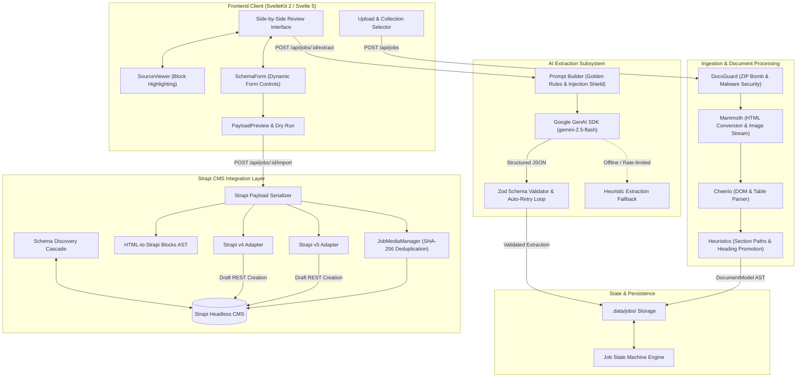
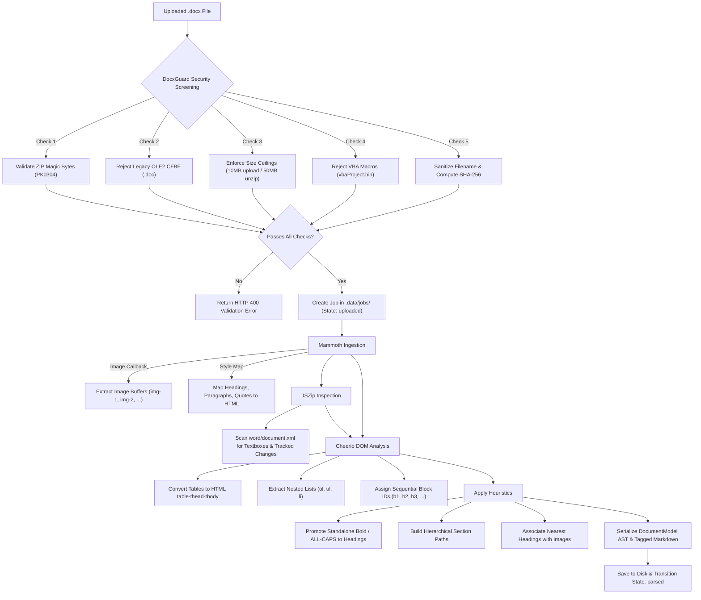
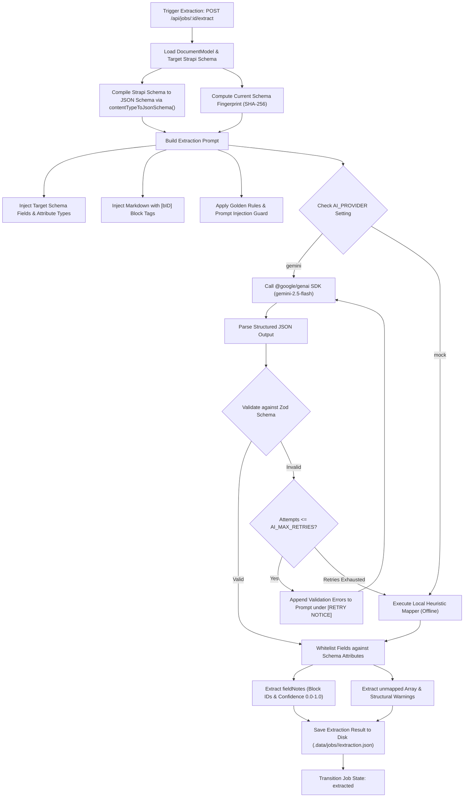
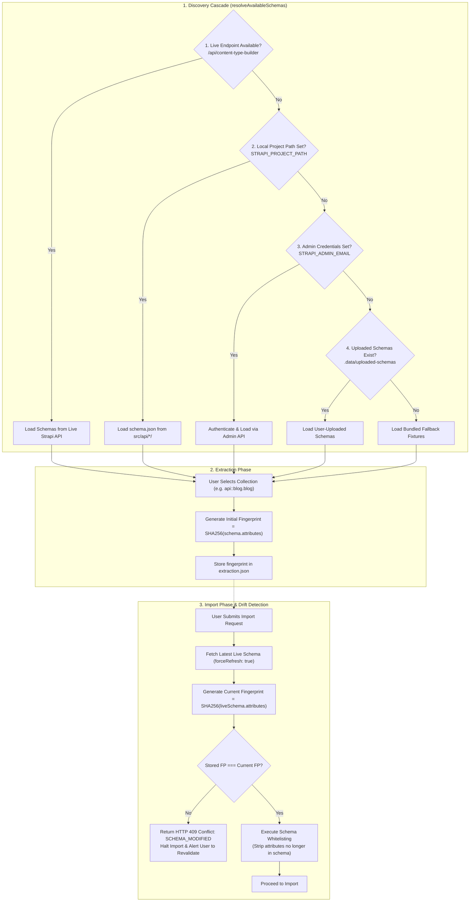
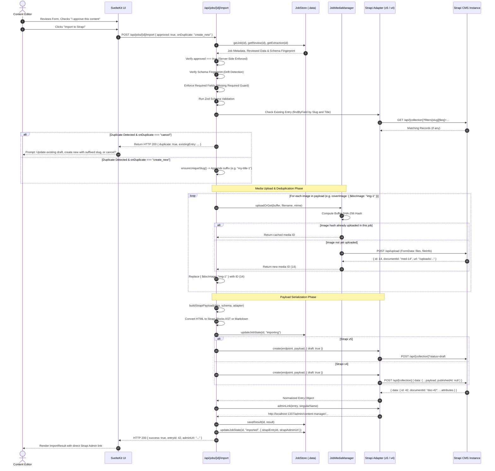

# DocuFlow: End-to-End Workflow & Architecture Guide

---

## 1. System Architecture Overview

DocuFlow connects unstructured Microsoft Word `.docx` documents to structured Strapi collections through a multi-stage, human-in-the-loop pipeline.

### High-Level System Architecture Diagram



---

## 2. Document Processing & Ingestion Workflow

Before any AI processing occurs, the uploaded file undergoes strict security verification, parsing, and normalization.

### Document Processing Workflow Diagram



---

## 3. AI-Based Extraction & Mapping Workflow

The extraction engine transforms the parsed document AST into structured content matching the target Strapi schema.

### AI Extraction & Mapping Flow Diagram



---

## 4. Strapi Schema Synchronization & Drift Workflow

Strapi collections evolve over time. DocuFlow implements dynamic schema discovery and drift detection to prevent data corruption.

### Schema Synchronization Flow Diagram



---

## 5. Final Data Import Sequence

The final stage executes the import into Strapi with media deduplication, duplicate checking, and draft enforcement.

### Final Data Import Sequence Diagram



---

## 6. End-to-End Practical Example: Test Lab Booking Document

The following real-world walkthrough demonstrates how a complex Word document containing headings, paragraphs, and a multi-column table is ingested, transformed, and imported into Strapi.

### 6.1 Source Word Document Structure
The source document (`Booking_Third_Party_Test_Lab.docx`) contains:
* **Title:** Booking a Third-Party Test Lab
* **Intro:** Overview of battery testing compliance.
* **Section 1:** Choosing the lab (scope, accreditation).
* **Section 2:** The first request, followed by an 8-row table:
  - Columns: `Field` | `Example` | `Why the lab needs it`
  - Rows: Who approves, Device under test, Samples available, Shipping state, Witnessing, Deliverables, Dates, End of life.

### 6.2 Target Strapi Schema (`api::blog.blog`)
* `title`: string
* `description`: string
* `content`: blocks (Strapi Blocks AST)
* `seo`: component (`component.seo` - single)
* `contentNew`: component (`component.content-new` - repeatable):
  - `title`: string
  - `content`: text

### 6.3 Stage 1: Document Parsing Output
The table in Section 2 is parsed into valid HTML table markup:
```html
<table>
  <thead>
    <tr>
      <th>Field</th>
      <th>Example</th>
      <th>Why the lab needs it</th>
    </tr>
  </thead>
  <tbody>
    <tr>
      <td>Who approves</td>
      <td>Validation lead approves</td>
      <td>Ensures budget and authority</td>
    </tr>
    <tr>
      <td>Device under test</td>
      <td>NMC module, about 5.5 kWh, 32 kg</td>
      <td>Defines safety equipment requirements</td>
    </tr>
  </tbody>
</table>
```

### 6.4 Stage 2: AI Semantic Extraction Output
Gemini maps the two sections into two entries in the repeatable `contentNew` component:
```json
{
  "title": "Booking a Third-Party Test Lab",
  "description": "Essential checklist for booking automotive battery test labs.",
  "contentNew": [
    {
      "title": "Choosing the lab",
      "content": "<p>Start with the accreditation scope and test chamber availability.</p>"
    },
    {
      "title": "The first request",
      "content": "<table><thead><tr><th>Field</th><th>Example</th><th>Why the lab needs it</th></tr></thead><tbody><tr><td>Who approves</td><td>Validation lead approves</td><td>Ensures budget and authority</td></tr><tr><td>Device under test</td><td>NMC module, about 5.5 kWh, 32 kg</td><td>Defines safety equipment requirements</td></tr></tbody></table>"
    }
  ]
}
```

### 6.5 Stage 3: Interactive Review & Dry Run
1. In the UI, the editor sees:
   - `contentNew[0]`: Title "Choosing the lab", content with introductory paragraph.
   - `contentNew[1]`: Title "The first request", content displaying the rendered HTML table.
2. The editor validates all 8 table rows and verifies column headers.
3. The editor checks the approval box and triggers a Dry Run to verify that Strapi will accept the payload.

### 6.6 Stage 4: Strapi Ingestion
1. Strapi receives the payload at `POST /api/blogs?status=draft`.
2. Strapi stores the entry in the `blogs` collection and the two component entries in `components_component_content_news`.
3. The table markup inside `contentNew[1].content` is preserved completely.
4. The user clicks the link to open the entry in the Strapi Admin Panel and verifies the content.

